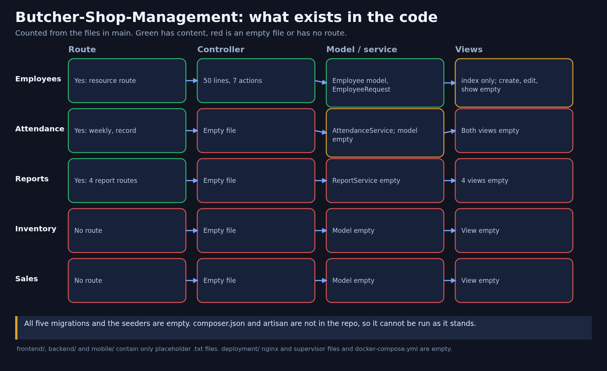

# Butcher-Shop-Management

A work-in-progress butcher shop management project (employees, attendance, inventory, sales, reports). It is mostly scaffolding so far: only the employee module has real code.

## Current status

| Area | Route | Controller | Model / service | Views |
| --- | --- | --- | --- | --- |
| Employees | resource route | 50 lines, 7 actions | Employee model, EmployeeRequest | index only |
| Attendance | weekly, record | empty | AttendanceService (model empty) | empty |
| Reports | 4 routes | empty | ReportService empty | empty |
| Inventory | none | empty | empty | empty |
| Sales | none | empty | empty | empty |

- The five migrations and the seeders are empty.
- `composer.json` and `artisan` are not in the repo, so it cannot be run as it stands.
- `frontend/`, `backend/` and `mobile/` hold only placeholder `.txt` files. The nginx, supervisor and docker-compose files are empty.
